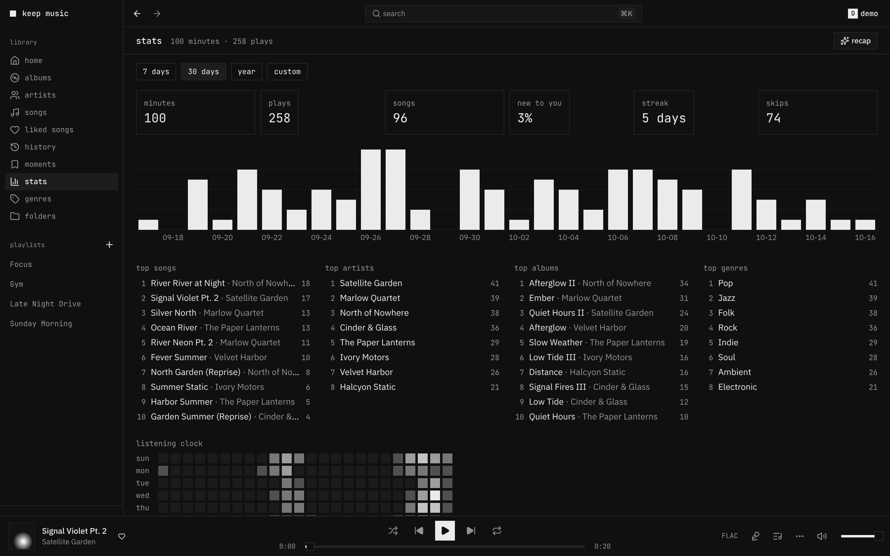
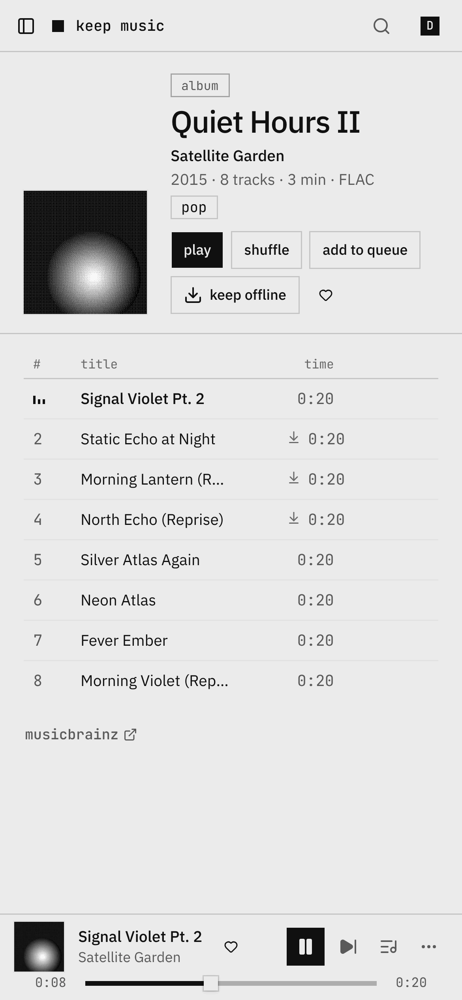

<div align="center">

# keep music

**A monochrome web player for your Navidrome library.**
Square covers, hairline borders, synced lyrics, a queue you can see, and nothing on screen when nothing is playing.

[](https://github.com/FindMalek/keep-player/actions/workflows/ci.yml)
[](https://github.com/FindMalek/keep-player/releases)
[](https://github.com/FindMalek/keep-player/pkgs/container/keep-player)


[](LICENSE)

<picture>
  <source media="(prefers-color-scheme: light)" srcset="docs/album-lyrics-light.png">
  
</picture>

</div>

## Why

Your own music deserves a player as good as the streaming apps, and better where they cut corners:

| | keep music | Spotify web player |
|---|---|---|
| your files, your server | ✓ | — |
| search that forgives typos, accents, missing spaces | ✓ | partly |
| search by a half-remembered lyric, and play **from that line** | ✓ | exact words only, plays from the start |
| lyrics timing you can nudge per song, saved across devices | ✓ | — |
| next songs downloaded ahead, playing offline in the browser | ✓ | — |
| every action on the keyboard, a searchable cheat sheet (`?`), rebindable | ✓ | some shortcuts |
| start on your phone, continue here (any Subsonic app, e.g. Arpeggi) | ✓ | ✓ (Connect) |

## Features

- **Search** (`⌘K`): one box for songs, albums, artists, playlists, lyrics and commands. Typo-tolerant, ranked by what
  you play, with filters (`artist:` `year:1990..1999` `is:liked` `format:flac` …). [search](docs/search.md)
- **Lyrics** for nearly every song: Navidrome's, else LRCLIB's, cached and fetched ahead. They follow the song
  word by word, full screen with `⇧F`, and `[` `]` fix the timing per song. [lyrics](docs/lyrics.md)
- **Playback** that doesn't stutter: two decks for gapless handover, ReplayGain (album gain in album order), the
  next songs precached by a service worker (instant seeks, plays offline), stalls recovered in place.
- **Queue** you can see and steer: your queue apart from the album or playlist it came from, balanced shuffle,
  undo for removals, stop after this song, sleep timer.
- **Keyboard first**: everything has a key, `?` shows them all, lists move with `j`/`k`, `x` selects.
  [shortcuts](docs/shortcuts.md)
- **Library**: home (recently added, played, most played, rediscover), albums, artists with bio and top songs,
  songs, genres, liked songs, your folders as on disk, playlists in folders (`Chill / Night`).
- **With your phone**: the play queue hands off both ways with Arpeggi or any OpenSubsonic app; likes, ratings,
  playlists and plays are the server's, so every app agrees. [sync](docs/sync.md)
- **Fast**: a 10k-song list renders ~40 rows, the library is cached in the browser so a reload paints instantly,
  covers are resized WebP served forever-cached, the first screen is under 160 KB of JS (gzip).
- **Mac media keys, Now Playing, a mini player** (always on top) and scrobbling back to Navidrome.

<table>
  <tr>
    <td width="50%"></td>
    <td width="50%"></td>
  </tr>
  <tr>
    <td><sub><b>home</b>: recently added, rediscover, most played</sub></td>
    <td><sub><b>stats</b>: minutes, streaks, top lists, a listening clock</sub></td>
  </tr>
  <tr>
    <td></td>
    <td></td>
  </tr>
  <tr>
    <td><sub><b>search</b> (<code>⌘K</code>): songs, albums, artists, lyrics, commands</sub></td>
    <td><sub><b>queue</b>: yours, apart from the album it came from</sub></td>
  </tr>
</table>

<p align="center"></p>

All screenshots are the [generated demo library](docs/demo-library.md): synthesized tracks and dithered covers, no real music.
The album shot has a light twin, served automatically on a light system theme.

## Quick start

```yaml
# compose.yaml, next to your Navidrome
services:
  player:
    image: ghcr.io/findmalek/keep-player:latest   # amd64
    restart: unless-stopped
    environment:
      NAVIDROME_URL: http://navidrome:4533        # as this container reaches Navidrome
    ports:
      - "8080:8080"
    volumes:
      - player-data:/data
volumes:
  player-data:
```

`docker compose up -d`, open `http://localhost:8080`, sign in with your Navidrome account. The sign-in screen checks
the server first and tells you what to fix if it can't reach it. [Getting started](docs/getting-started.md)

## Docs

| | |
|---|---|
| [getting started](docs/getting-started.md) | run it, sign in, first run |
| [configuration](docs/configuration.md) | every setting (generated from the code) |
| [deploy](docs/deploy/README.md) | full stack, Traefik, Caddy, nginx, Dokploy, image tags, health |
| [shortcuts](docs/shortcuts.md) | every key (generated from the code) |
| [search](docs/search.md) · [lyrics](docs/lyrics.md) · [sync](docs/sync.md) · [spotify import](docs/spotify-import.md) · [listen together](docs/listen-together.md) | how they work |
| [architecture](docs/architecture.md) · [security](docs/security.md) | how it's built, what's protected |
| [demo library](docs/demo-library.md) · [previews](docs/previews.md) | the generated library, and per-PR preview deployments |
| [troubleshooting](docs/troubleshooting.md) | when something's off |
| [contributing](CONTRIBUTING.md) · [roadmap](docs/ROADMAP.md) | working on it |

## FAQ

**Does it work on a phone?** Yes: the layout follows the window down to 320 px, and it installs as an app from the
browser's menu. For a native feel use a Subsonic app too (Arpeggi, Substreamer, Symfonium…); the queue hands off between
them.

**Can I try it without my own music?** Yes: `bun run demo:library ./demo-music` generates a library and
[`compose.demo.yaml`](compose.demo.yaml) serves it from a Navidrome. See [demo library](docs/demo-library.md).

**Does it change my music files?** No. It reads through Navidrome's API. Likes, ratings, playlists and plays are
stored by Navidrome; keep music keeps only its own data (sessions, its search and lyrics cache, history) in `/data`.

**Does it phone home?** No. It talks to your Navidrome and, for missing lyrics, to LRCLIB (`LRCLIB_URL=` turns that
off). The release check is off unless you set `UPDATE_CHECK=on`.

**Several Navidrome servers?** `NAVIDROME_SERVERS=home=http://a:4533,friend=https://b` and pick at sign-in.

**Other Subsonic servers?** Anything that speaks OpenSubsonic should work; it's tested against Navidrome.

## Develop

A Bun workspace: `apps/player` (the React app), `apps/server` (the Bun server that serves it and proxies Navidrome),
`packages/shared` (types both sides use).

```sh
bun install
bun run mock                                       # fake Navidrome on :4599 with 10k songs (demo / demo)
NAVIDROME_URL=http://127.0.0.1:4599 bun run dev    # app on :8080, hot reload
bun run check                                      # typecheck, lint, unit tests, bundle size, generated docs
bun run e2e                                        # Playwright against the mock
bun run demo:library ./demo-music                  # a real, copyright-free library for a real Navidrome
```

Every pull request gets a [preview deployment](docs/previews.md) with a demo account. More in
[CONTRIBUTING](CONTRIBUTING.md).

## Credits

Built on [Navidrome](https://www.navidrome.org), [Bun](https://bun.sh), [React](https://react.dev),
[shadcn/ui](https://ui.shadcn.com) (on [Base UI](https://base-ui.com)) and [LRCLIB](https://lrclib.net). The demo
library's tracks are generated by this repository; there is no third-party music in it.

## License

MIT
