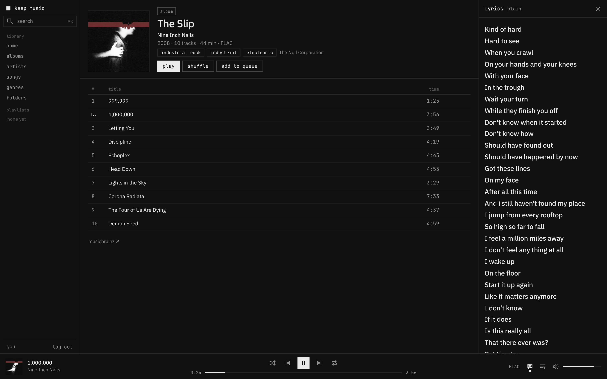
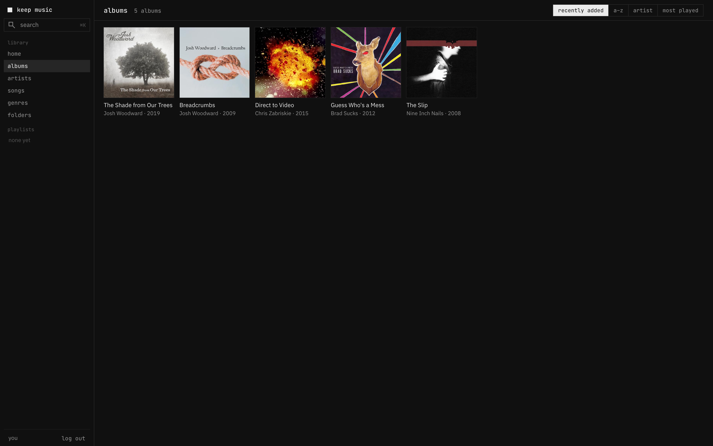
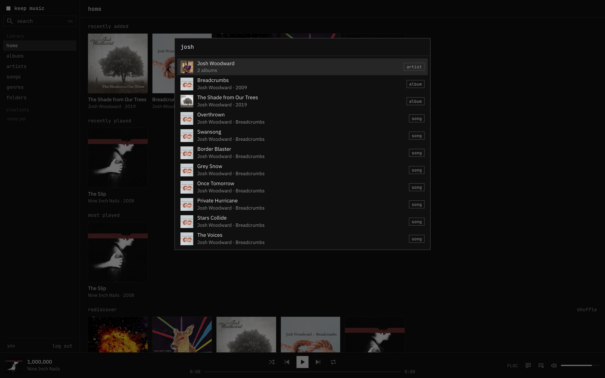
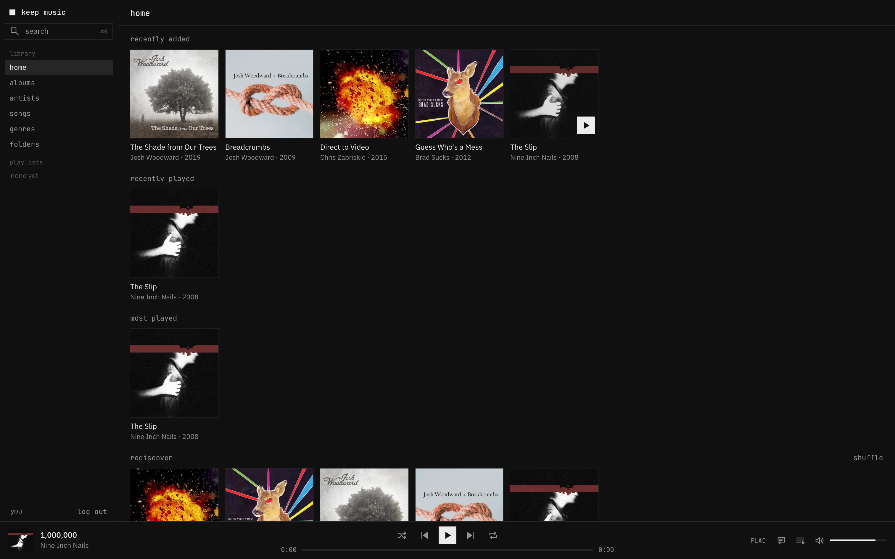
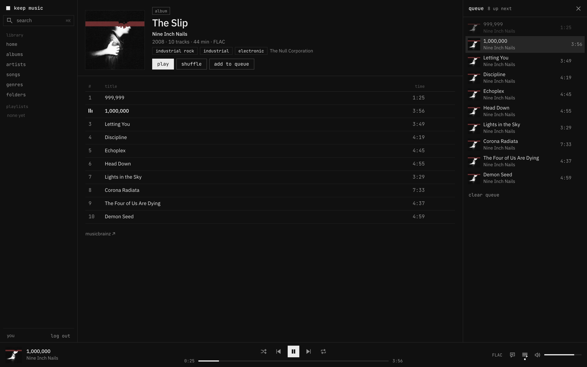

<div align="center">

# keep music

**A monochrome web player for your Navidrome library.**
Square covers, hairline borders, synced lyrics, a queue you can see, and nothing on screen when nothing is playing.




</div>

## Features

- **Library**: home (recently added, recently played, most played, rediscover), albums with sorting, artists A–Z
  with bio and popular tracks, all songs, genres as tags, and your **folders** exactly as they sit on disk.
- **Playlists with folders**: name a playlist `Chill / Night` and it shows up inside a *Chill* folder.
- **Player bar** with shuffle, repeat (all / one), seek and volume — and it **disappears when the queue is empty**.
- **Queue panel** (jump, remove, clear) and a **synced lyrics** panel that follows the song; click a line to seek.
- **⌘K search** across artists, albums and songs, keyboard first.
- **ReplayGain** through Web Audio: album gain when an album plays in order, track gain otherwise, clipped to the peak.
- **Mac media keys and Now Playing** (Media Session), **scrobbling** back to Navidrome, and the queue and
  position survive a reload.
- **Keyboard**: `space` play/pause · `←` `→` seek · `shift ←/→` previous/next · `m` mute · `s` shuffle ·
  `r` repeat · `q` queue · `l` lyrics · `⌘K` or `/` search.

| albums | search |
|---|---|
|  |  |
| **home** | **queue** |
|  |  |

## How it works

A small Bun server serves the app and forwards `/rest/*` to Navidrome on your internal network:

- **same origin**, so there's no CORS and Web Audio can apply ReplayGain to the stream;
- `Range` headers pass through, so seeking in a FLAC is instant;
- login happens server-side: the server turns your password into a Subsonic token (`md5(password + salt)`),
  checks it against Navidrome and hands the browser only `{user, token, salt}`. The password is never stored.

Built for the desktop web. On a phone, use a native Subsonic app.

## Run it

```yaml
services:
  player:
    build: .
    restart: unless-stopped
    environment:
      NAVIDROME_URL: http://navidrome:4533   # reachable from this container
    ports:
      - "8080:8080"                          # or route it through your reverse proxy
```

Sign in with any Navidrome account. Album metadata, cover art, genres and lyrics come from Navidrome, so tags
from [beets](https://beets.io) (MusicBrainz, LRCLIB synced lyrics, ReplayGain) show up as-is.

## Develop

```sh
bun install
NAVIDROME_URL=http://localhost:4533 bun src/server.ts
bun run typecheck
```

Deploying to your own box: put `KEEP_HOST`, `COMPOSE_ID` and `SOURCE_DIR` in a git-ignored `.deploy.env` and run
`./deploy.sh` (Dokploy).

## Credits

Screenshots use Creative Commons music: *The Slip* by Nine Inch Nails (CC BY-NC-SA 3.0), *The Shade from Our Trees*
and *Breadcrumbs* by Josh Woodward (CC BY 3.0), *Direct to Video* by Chris Zabriskie (CC BY 3.0),
*Guess Who's a Mess* by Brad Sucks (CC BY-NC-SA 3.0).

## License

MIT
