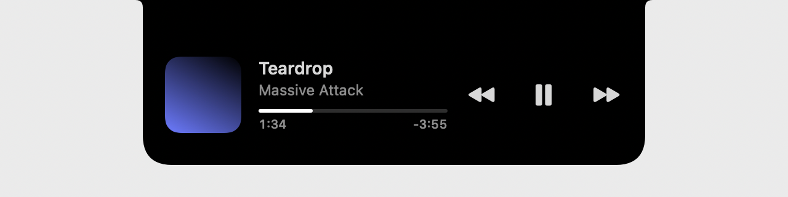
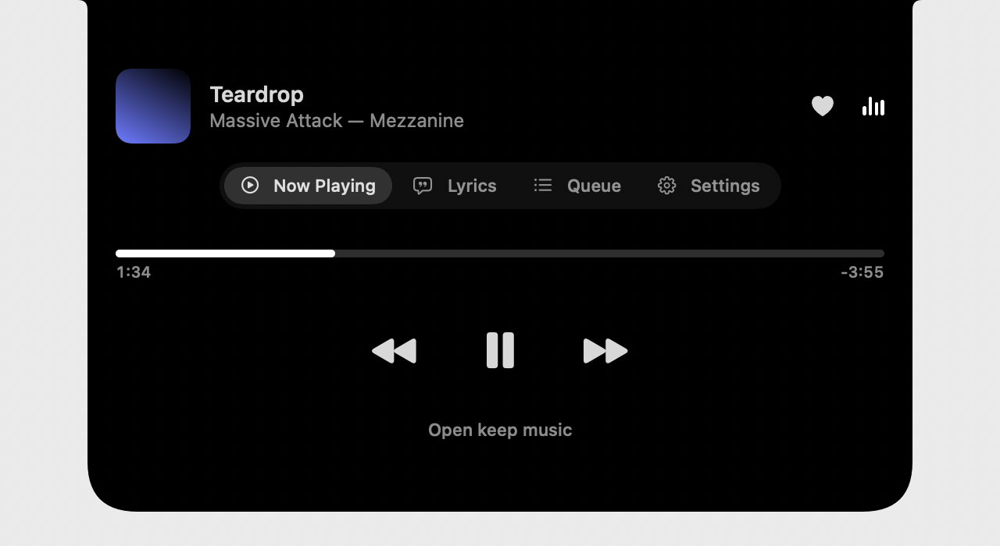

# keep music for macOS

The player in its own window, and an island around the notch, made to feel like it shipped with the Mac.

| | |
|---|---|
|  | **Playing:** the cover left of the notch, bars bouncing right of it. |
|  | **Hover:** it grows into the song, where it is, and ⏮ ⏯ ⏭. |
|  | **Click:** Now Playing (seek by dragging), Lyrics (follow along, click a line to jump), Queue (click to play), Settings. |

- **The notch:** on by default on Macs that have one, off on the rest (a Mac mini, an external display only); switch it
  in the island's Settings. Without a notch there's a mini player that stays on top (⌘⇧M) and a menu bar item.
- **Battery:** nothing polls. The player reports changes; the playhead moves on by itself between reports and only
  while you're looking at it. The bars are a Core Animation loop the system renders at 24 fps, stopped when paused, and
  the island's window is gone when nothing plays.
- **Closing the window keeps the music going**; the Dock icon or ⌘1 brings it back. Media keys and Now Playing work
  through WebKit, the same as in Safari.
- **Your login** stays in the app between launches (its own WebKit store, apart from Safari's).

## Install

Download `keep-music-macos.zip` from the [latest release](https://github.com/FindMalek/keep-player/releases/latest),
unzip, move **keep music** to Applications. It isn't signed by Apple yet: the first time, right-click it → **Open**
(or `xattr -dr com.apple.quarantine "/Applications/keep music.app"`). It asks for your keep music address once.
macOS 14 or later.

## Build

```sh
apps/macos/build.sh                                   # → apps/macos/dist/keep music.app (Apple silicon + Intel)
swift run --package-path apps/macos KeepMusic --preview /tmp/island   # the island's states as PNGs
```

No dependencies: AppKit, SwiftUI and WebKit. The page talks to the app through `apps/player/src/lib/native.ts`.
